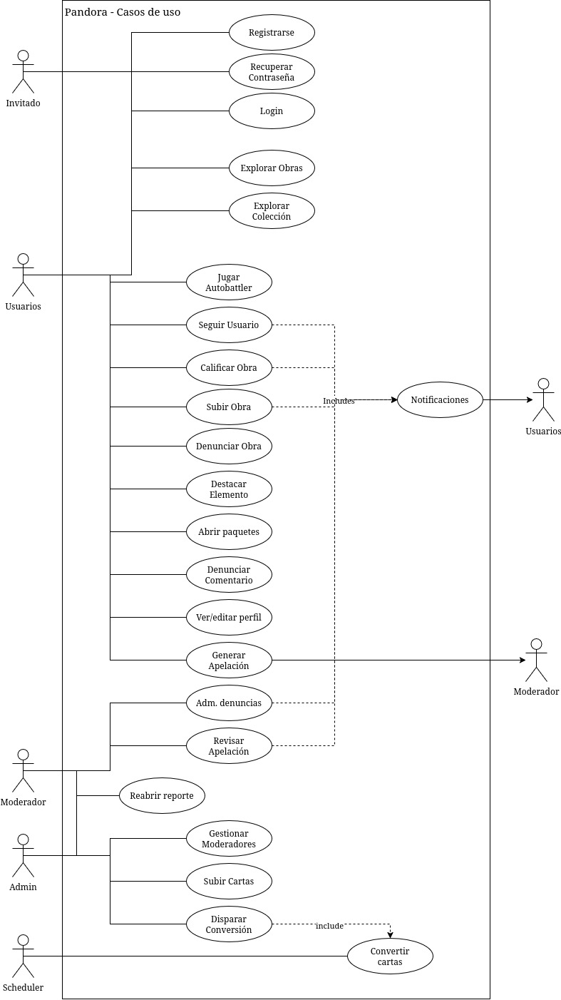

# Pandora — Casos de Uso

Este documento cubre actores, permisos y el catálogo completo de casos de uso, con sus flujos principales, alternativos y observaciones.

---

## Índice

- [Diagrama](#diagrama)
- [Actores y permisos](actores.md)
  - [Invitado](actores.md#invitado)
  - [Usuario autenticado](actores.md#usuario-autenticado)
  - [Moderador](actores.md#moderador)
  - [Admin](actores.md#admin)
- [Catálogo de casos de uso](#catálogo-de-casos-de-uso) — cada fila enlaza al caso de uso
- [Flujo consolidado de moderación (CU21–CU23, CU26–CU28)](flujo-moderacion.md)
- [Documento completo](completo.md) — todos los casos de uso en una sola página

---

## Diagrama

> El diagrama todavía refleja la numeración original de los casos de uso (CU01–CU23); la tabla del [catálogo](#catálogo-de-casos-de-uso) es la referencia vigente tras la reorganización.

---

## Catálogo de casos de uso

Los casos de uso cubren registro, verificación y recuperación de cuenta, perfil, obras (subir/editar/eliminar/comentar/calificar), conversión a carta, colección, moderación, seguimiento, batalla, paquetes, destacados, reportes, notificaciones y las herramientas de administración/apelaciones.

| ID | Nombre | Actor principal |
|---|---|---|
| [CU01](cu01-registrarse.md) | Registrarse | Invitado |
| [CU02](cu02-verificar-email.md) | Verificar email | Invitado / cuenta pendiente de verificación |
| [CU03](cu03-login.md) | Login | Invitado |
| [CU04](cu04-recuperar-contrasena-olvidada.md) | Recuperar contraseña olvidada | Invitado |
| [CU05](cu05-limpieza-de-cuentas-no-verificadas.md) | Limpieza de cuentas no verificadas | CRON / sistema |
| [CU06](cu06-ver-editar-perfil.md) | Ver/editar perfil | Usuario autenticado |
| [CU07](cu07-cambiar-email.md) | Cambiar email | Usuario autenticado |
| [CU08](cu08-cambiar-contrasena.md) | Cambiar contraseña | Usuario autenticado |
| [CU09](cu09-subir-obra.md) | Subir obra | Usuario autenticado |
| [CU10](cu10-editar-obra.md) | Editar obra | Usuario autenticado |
| [CU11](cu11-eliminar-obra.md) | Eliminar obra | Usuario autenticado |
| [CU12](cu12-explorar-obras.md) | Explorar obras | Invitado o usuario |
| [CU13](cu13-comentar-obra.md) | Comentar obra | Usuario autenticado |
| [CU14](cu14-calificar-obra-mediante-q2q.md) | Calificar obra mediante Q2Q | Usuario autenticado |
| [CU15](cu15-conversion-de-obra-a-carta.md) | Conversión de obra a carta | CRON / sistema |
| [CU16](cu16-explorar-coleccion-cartas.md) | Explorar colección/cartas | Invitado o usuario autenticado |
| [CU17](cu17-abrir-paquete.md) | Abrir paquete | Usuario autenticado |
| [CU18](cu18-jugar-autobattler.md) | Jugar autobattler | Usuario autenticado |
| [CU19](cu19-seguir-usuario.md) | Seguir usuario | Usuario autenticado |
| [CU20](cu20-destacar-obra-o-carta.md) | Destacar obra o carta | Usuario autenticado |
| [CU21](cu21-denunciar-obra.md) | Denunciar obra | Usuario autenticado |
| [CU22](cu22-denunciar-comentario.md) | Denunciar comentario | Usuario autenticado |
| [CU23](cu23-administrar-denuncias.md) | Administrar denuncias | Moderador |
| [CU24](cu24-notificaciones.md) | Notificaciones | Usuario autenticado |
| [CU25](cu25-gestionar-rol-de-moderador.md) | Gestionar rol de moderador | Admin |
| [CU26](cu26-reabrir-un-reporte-resuelto.md) | Reabrir un reporte resuelto | Admin |
| [CU27](cu27-apelar-una-sancion.md) | Apelar una sanción | Usuario autenticado afectado |
| [CU28](cu28-revisar-una-apelacion.md) | Revisar una apelación | Moderador o Admin |
| [CU29](cu29-cargar-carta-directamente.md) | Cargar carta directamente (Admin) | Admin |
| [CU30](cu30-disparar-el-ciclo-de-conversion-manualmente.md) | Disparar el ciclo de conversión manualmente (Admin) | Admin |
