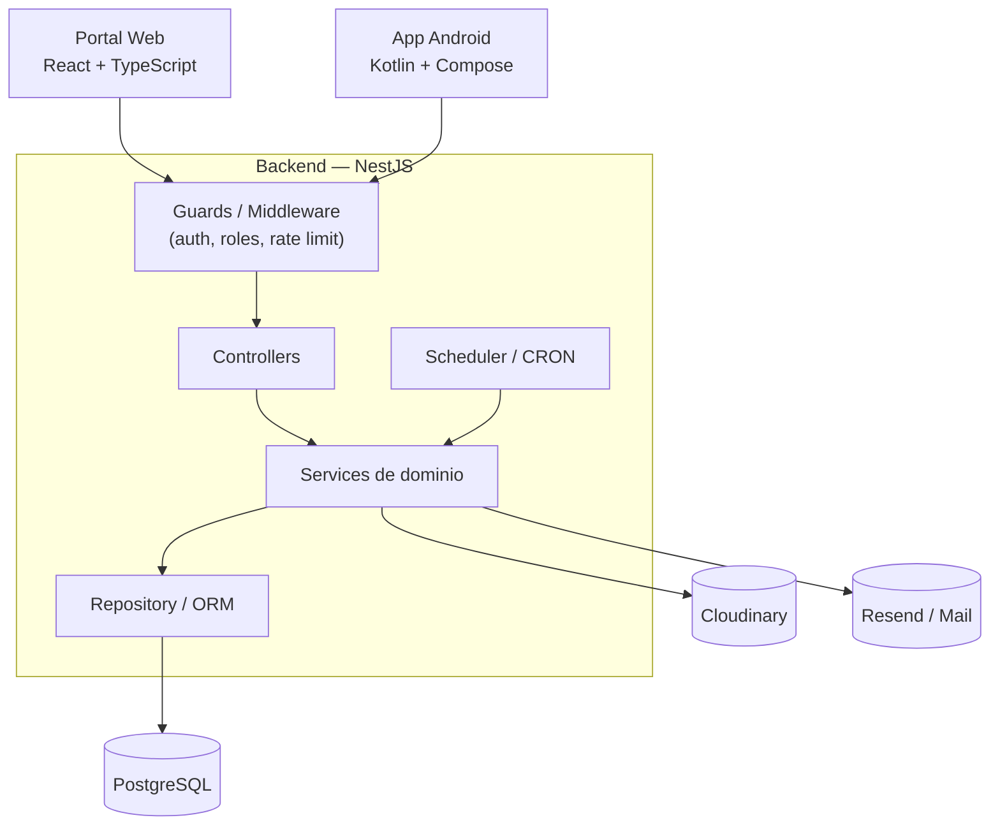
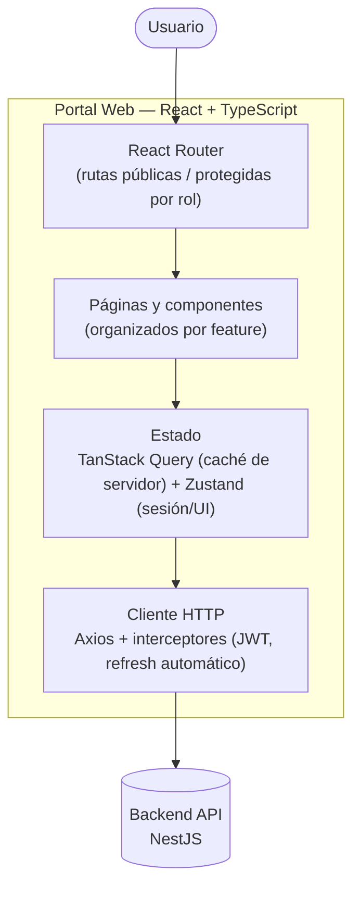
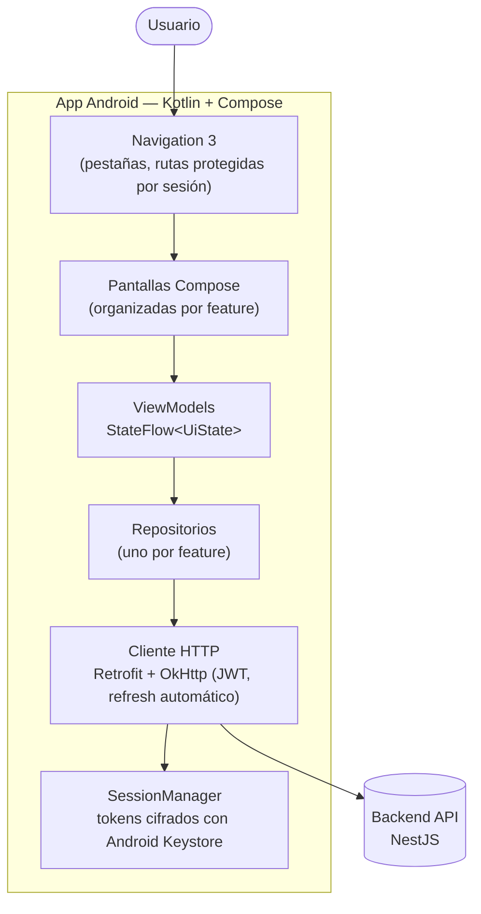
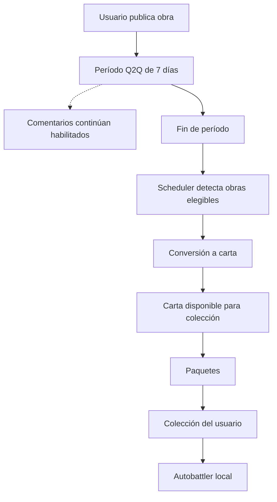

# Pandora — Diseño de Arquitectura

Este documento cubre la vista general del sistema, la organización por módulos, las capas, el almacenamiento de imágenes, los procesos periódicos (conversión, paquetes, batalla), la observabilidad y las recomendaciones de diseño.

---

## Índice

- [Vista general del sistema](#vista-general-del-sistema)
- [Arquitectura del Portal Web (Frontend)](#arquitectura-del-portal-web-frontend)
- [Arquitectura de la App Android](#arquitectura-de-la-app-android)
- [Organización del backend por módulos](organizacion-modulos.md)
  - [Capas recomendadas](organizacion-modulos.md#capas-recomendadas)
- [Observabilidad / logging (RNF14)](observabilidad.md)
- [Almacenamiento de imágenes (Cloudinary)](almacenamiento-imagenes.md)
  - [Flujo](almacenamiento-imagenes.md#flujo)
  - [Consideraciones](almacenamiento-imagenes.md#consideraciones)
- [Conversión de obras a cartas (proceso periódico)](conversion.md)
  - [Objetivo](conversion.md#objetivo)
  - [Flujo](conversion.md#flujo)
  - [Estados](conversion.md#estados)
  - [Idempotencia](conversion.md#idempotencia)
  - [Frecuencia del scheduler](conversion.md#frecuencia-del-scheduler)
  - [Disparo manual (Admin, demo)](conversion.md#disparo-manual-admin-demo)
- [Lógica de regeneración de paquetes](regeneracion-paquetes.md)
  - [Estado mínimo](regeneracion-paquetes.md#estado-mínimo)
  - [Cálculo](regeneracion-paquetes.md#cálculo)
- [Lógica de selección del rival (batalla)](seleccion-rival.md)
- [Recomendaciones de diseño para evitar deuda técnica](recomendaciones.md)
- [Resumen arquitectónico final](#resumen-arquitectónico-final)
- [Documento completo](completo.md) — todo el documento en una sola página

---

## Vista general del sistema

Elementos genéricos a propósito: qué controller/service/guard concreto compone cada módulo vive en [diagramas de clases de diseño](/clases-diseno/README.md#diagramas-de-clases-de-diseño) y [diseño de componentes](/diseno-componentes/README.md). El detalle interno de Portal Web y de App Android se desarrolla a continuación.

El backend es la única fuente de autoridad para reglas de negocio: el frontend (web o Android) no debe reimplementar validaciones críticas, ya que ambos clientes comparten exactamente el mismo backend y contrato de API.

---

## Arquitectura del Portal Web (Frontend)

Detalle interno del nodo "Portal Web" del diagrama anterior. Es una SPA React + TypeScript (Vite) organizada por feature (`src/features/<dominio>/{api,hooks,store?,components,pages,types}`), sin lógica de negocio propia: toda regla de negocio vive en el backend, el cliente sólo la consume.

Capas, de afuera hacia adentro:

- **React Router**: define las rutas públicas (explorar, detalle de obra/carta, login) y las protegidas (`RequireAuth`/`RequireVerified`/`RequireRole`), redirigiendo según el estado de sesión.
- **Páginas y componentes**: una carpeta por feature (`artworks`, `cards`, `battle`, `users`, etc.), cada una con sus propias páginas y componentes de UI (shadcn/ui + Tailwind).
- **Estado**: TanStack Query cachea y sincroniza todo dato que viene del servidor (listados, detalle, mutaciones); Zustand sólo guarda lo que no es caché de servidor — sesión (`accessToken`/`refreshToken`/usuario) y estado efímero de UI (p. ej. la simulación de batalla en curso).
- **Cliente HTTP**: una única instancia de Axios con interceptores — adjunta el header `Authorization`, normaliza todo error al formato de [convenciones de API §2](/api-conventions.md#2), y reintenta con refresh automático de token ante un `401`.

El frontend nunca recalcula reglas de negocio (rareza, estadísticas de carta, resultado de un reporte, etc.): las consume tal como las devuelve el backend. La única excepción documentada es el simulador de batalla, que corre 100% en el cliente por diseño (ver [convenciones de API §15](/api-conventions.md#15) y `battle-formula.md`).

---

## Arquitectura de la App Android

Detalle interno del nodo "App Android" del primer diagrama. Es una app Kotlin + Jetpack Compose de un solo módulo, organizada por feature (`ui/<dominio>` y `data/<dominio>`, con lo transversal en `core/`). Igual que el portal web, es un cliente puro del backend.

Capas, de afuera hacia adentro:

- **Navigation 3**: barra inferior con una pila de navegación por pestaña; las entradas que requieren sesión redirigen al login según el estado expuesto por `SessionManager`.
- **Pantallas y ViewModels**: cada feature (`artworks`, `cards`, `packs`, `battle`, `profile`, etc.) tiene sus pantallas Compose y un ViewModel que expone un `UiState` como `StateFlow`.
- **Repositorios**: uno por dominio, sobre su interfaz Retrofit; traducen el error estándar del backend a un `AppError` según su `code` (ver [convenciones de API §2](/api-conventions.md#2)).
- **Cliente HTTP**: OkHttp adjunta el header `Authorization` y, ante un `401`, refresca el token bajo un mutex (los refresh tokens son de un solo uso) y reintenta. Los tokens se guardan cifrados con una clave del Android Keystore ([convenciones de API §5.4](/api-conventions.md#5)).
- **Dependencias**: se construyen a mano en un `AppContainer` único, sin framework de DI.

Al igual que en web, la única lógica de negocio local es el simulador de batalla (`BattleEngine`), que implementa `battle-formula.md` tal cual para que ambos clientes den el mismo resultado.

---

## Resumen arquitectónico final

Pandora queda definido como un sistema cliente-servidor compuesto por un portal web y una aplicación Android que consumen una API NestJS. PostgreSQL centraliza usuarios, contenido, calificaciones, cartas, inventarios, relaciones, moderación y notificaciones. Cloudinary gestiona los assets gráficos.

La principal secuencia de negocio es:

