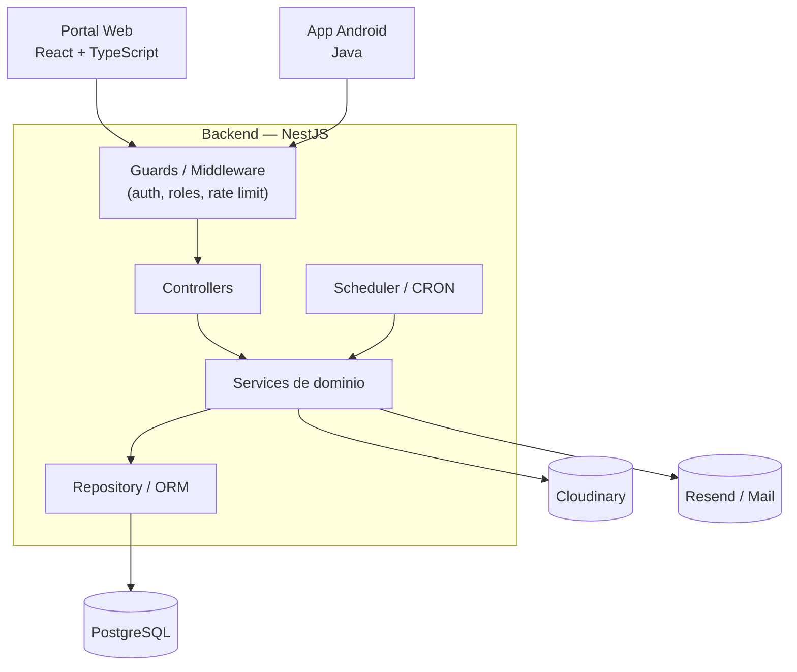

# Pandora — Diseño de Arquitectura

Este documento cubre la vista general del sistema, la organización por módulos, las capas, el almacenamiento de imágenes, los procesos periódicos (conversión, paquetes, batalla), la observabilidad y las recomendaciones de diseño.

---

## Índice

- [Vista general del sistema](#vista-general-del-sistema)
- [Organización del backend por módulos](organizacion-modulos.md)
  - [Capas recomendadas](organizacion-modulos.md#capas-recomendadas)
- [Observabilidad / logging (RNF14)](observabilidad.md)
- [Almacenamiento de imágenes (Cloudinary)](almacenamiento-imagenes.md)
  - [Flujo](almacenamiento-imagenes.md#flujo)
  - [Consideraciones](almacenamiento-imagenes.md#consideraciones)
- [Conversión de obras a cartas (proceso periódico)](conversion.md)
  - [Objetivo](conversion.md#objetivo)
  - [Flujo](conversion.md#flujo)
  - [Estados](conversion.md#estados)
  - [Idempotencia](conversion.md#idempotencia)
  - [Frecuencia del scheduler](conversion.md#frecuencia-del-scheduler)
  - [Disparo manual (Admin, demo)](conversion.md#disparo-manual-admin-demo)
- [Lógica de regeneración de paquetes](regeneracion-paquetes.md)
  - [Estado mínimo](regeneracion-paquetes.md#estado-mínimo)
  - [Cálculo](regeneracion-paquetes.md#cálculo)
- [Lógica de selección del rival (batalla)](seleccion-rival.md)
- [Recomendaciones de diseño para evitar deuda técnica](recomendaciones.md)
- [Resumen arquitectónico final](#resumen-arquitectónico-final)
- [Documento completo](completo.md) — todo el documento en una sola página

---

## Vista general del sistema



Elementos genéricos a propósito: qué controller/service/guard concreto compone cada módulo vive en [diagramas de clases de diseño](/clases-diseno/README.md#diagramas-de-clases-de-diseño) y [diseño de componentes](/diseno-componentes/README.md); el detalle interno de Portal Web y App Android tendrá su propio diagrama aparte.

El backend es la única fuente de autoridad para reglas de negocio: el frontend (web o Android) no debe reimplementar validaciones críticas, ya que ambos clientes comparten exactamente el mismo backend y contrato de API.

---

## Resumen arquitectónico final

Pandora queda definido como un sistema cliente-servidor compuesto por un portal web y una aplicación Android que consumen una API NestJS. PostgreSQL centraliza usuarios, contenido, calificaciones, cartas, inventarios, relaciones, moderación y notificaciones. Cloudinary gestiona los assets gráficos.

La principal secuencia de negocio es:

```text
Usuario publica obra
        |
        v
Período Q2Q de 7 días
        |
        +--> comentarios continúan habilitados
        |
        v
Fin de período
        |
        v
Scheduler detecta obras elegibles
        |
        v
Conversión a carta
        |
        v
Carta disponible para colección
        |
        v
Paquetes
        |
        v
Colección del usuario
        |
        v
Autobattler local
```
