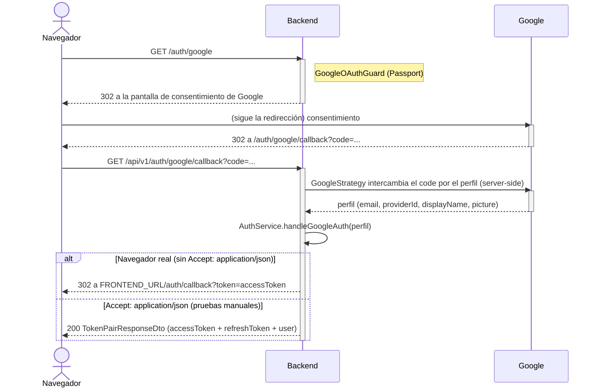
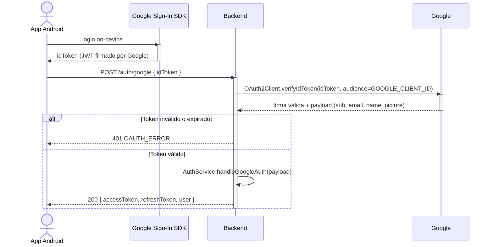

# Google (identidad federada / OAuth)

**Rol:** login social opcional, alternativa a email + contraseña. Dos flujos distintos según el cliente, que convergen en la misma lógica de vinculación de cuenta.

**Configuración:** `GOOGLE_CLIENT_ID`, `GOOGLE_CLIENT_SECRET`, `GOOGLE_CALLBACK_URL` (`src/config/google.config.ts`). Sin `GOOGLE_CLIENT_ID`/`GOOGLE_CLIENT_SECRET`, `GoogleStrategy` igual se registra (con placeholders `dummy-google-*`) pero cualquier intento real de autenticar contra Google falla del lado de Google, no del backend.

## Flujo Web — *authorization code* (Passport)

`GoogleOAuthGuard` (`AuthGuard('google')` de Passport) cubre tanto `GET /auth/google` (redirección inicial) como `GET /auth/google/callback` (donde Google redirige de vuelta con el `code`). `GoogleStrategy.validate()` sólo mapea el perfil recibido a una forma interna (`providerId`, `email`, `displayName`, `picture`) — es `AuthController.googleAuthCallback()` quien pasa ese perfil a `AuthService.handleGoogleAuth()`.

El callback responde de dos formas distintas según el header `Accept` de quien llamó:
- **Navegador real** (sin `Accept: application/json`): `302` a `${FRONTEND_URL}/auth/callback?token=<accessToken>` — el frontend toma el token de la query string. Nota: el `refreshToken` **no** viaja en esta redirección (queda fuera de la URL por diseño, ya que terminaría en el historial del navegador y en logs de servidores intermedios); el frontend web debe volver a autenticarse cuando ese `accessToken` expire.
- **Cliente que pide JSON explícitamente** (`Accept: application/json`, p. ej. pruebas manuales): `200` con el mismo `TokenPairResponseDto` que el resto de los flujos de auth (`accessToken` + `refreshToken` + `user`).

## Flujo Android — verificación de ID token

La app Android usa el SDK nativo de Google Sign-In para autenticar *on-device* y obtiene un ID token (JWT) firmado por Google directamente — nunca pasa por el flujo de redirección web.

`POST /auth/google` (`AuthController.googleLoginDirect`) delega en `AuthService.loginWithGoogleIdToken(idToken)`, que usa `google-auth-library` (`OAuth2Client.verifyIdToken`) para verificar la firma y la `audience` (`GOOGLE_CLIENT_ID`) del token recibido — esta es la única llamada de red que el backend mismo hace contra Google (a diferencia del flujo web, donde el intercambio code→perfil lo hace Passport dentro del mismo request de callback, pero sigue siendo el backend quien lo dispara). Un token inválido o expirado responde `401 OAUTH_ERROR`.

## Vinculación de cuenta (común a ambos flujos)

Ambos flujos terminan en `AuthService.handleGoogleAuth(googleUser)`:

1. Busca `OAuthAccount` por `(provider='google', provider_user_id)`. Si existe, usa esa cuenta (bloqueando sólo si está `SUSPENDED`; `BANNED` puede autenticarse — ver [clases de diseño, módulo `auth`](/clases-diseno/auth.md)).
2. Si no existe el vínculo, busca un `User` por email. Si ya existía (registrado con contraseña local, por ejemplo), lo vincula a esta cuenta de Google y marca `email_verified = true` (Google ya verificó ese correo por su cuenta).
3. Si tampoco existe el usuario, lo crea: username derivado del `displayName`/email (normalizado, con sufijo numérico si hay colisión), sin `password_hash` (login exclusivamente por Google desde entonces, salvo que más adelante use "forgot password" — ver nota en §5.2), `email_verified = true`, rol `user` por defecto.
4. Emite el mismo par `accessToken`/`refreshToken` que cualquier otro login.

**Scope solicitado:** `email profile` (`google.strategy.ts`) — lo mínimo necesario para email, nombre y foto de perfil.
