# Pandora — Tablas y Diagrama de Tablas

Este documento cubre el esquema físico de base de datos: tablas, columnas, tipos, constraints, enums e índices recomendados.

---

## Índice

- [Diagrama de tablas (notación textual)](#diagrama-de-tablas-notación-textual)
- [Diagrama](#diagrama)
- [Catálogo de tablas](#catálogo-de-tablas) — cada fila enlaza a la tabla
- [Índices recomendados](indices-recomendados.md)
- [Documento completo](completo.md) — todas las tablas en una sola página

---

## Diagrama de tablas (notación textual)

```text
users 1 ─── N artworks
users 1 ─── N artwork_comments
users 1 ─── N artwork_ratings
artworks 1 ─── N artwork_comments
artworks 1 ─── N artwork_ratings
artworks 1 ─── 1 cards
users N ─── N cards                    (user_cards)
users 1 ─── 1 card_packs
users N ─── N users                    (follows)
users N ─── N artworks                 (favorite_artworks)
users N ─── N cards                    (favorite_cards)
artworks N ─── N tags                  (artwork_tags)
users 1 ─── N notifications
artworks 1 ─── N artwork_reports
artwork_comments 1 ─── N comment_reports
users 1 ─── N reports (artwork_reports/comment_reports, como reporter/resolver)
users 1 ─── N email_verification_tokens
users 1 ─── N password_reset_tokens
users 1 ─── N refresh_tokens
users 1 ─── N oauth_accounts
users N ─── N roles                    (user_roles)
users 1 ─── N appeals                  (appellant_id)
users 1 ─── N appeals                  (reviewed_by, nullable)
artwork_reports  1 ─── 0..1 appeals    (report_target_type = artwork)
comment_reports  1 ─── 0..1 appeals    (report_target_type = comment)
```

---

## Diagrama

[Diagrama original en dbDiagram](https://dbdiagram.io/d/Pandora-6a9ee57bff72c756bcfca7b5)

```mermaid
erDiagram
    users {
        bigint id PK
        varchar username UK
        varchar email UK
        varchar password_hash "nullable, NULL en cuentas OAuth"
        boolean email_verified
        enum status "active, suspended, banned, pending_verification"
        varchar bio "nullable"
        varchar avatar_url "nullable"
        timestamp created_at
        timestamp updated_at "nullable"
    }

    roles {
        bigint id PK
        varchar name UK "user, moderator, admin"
        varchar description "nullable"
    }

    user_roles {
        bigint user_id PK, FK
        bigint role_id PK, FK
    }

    artworks {
        bigint id PK
        varchar title
        varchar description "nullable"
        bigint author_id FK
        varchar image_original_url
        varchar image_medium_url
        varchar image_thumbnail_url
        varchar image_public_id "nullable, id de Cloudinary"
        boolean conversion_request
        enum conversion_status "pending, processing, converted, skipped, failed"
        timestamp qualification_started_at
        boolean deleted
        timestamp created_at
        timestamp updated_at "nullable"
    }

    artwork_comments {
        bigint id PK
        bigint author_id FK
        bigint artwork_id FK
        varchar comment
        boolean deleted
        timestamp created_at
        timestamp updated_at "nullable"
    }

    artwork_ratings {
        bigint id PK
        bigint artwork_id FK
        bigint voter_id FK
        smallint stars "1 a 5"
        enum emotion "joy, fear, anger, serenity, grief, awe"
        timestamp created_at
        timestamp updated_at "nullable"
    }

    cards {
        bigint id PK
        bigint artwork_id FK, UK
        integer attack
        integer defense
        integer hp
        integer speed
        enum rarity "common, uncommon, rare, epic, legendary"
        boolean deleted
        timestamp created_at
        timestamp updated_at "nullable"
    }

    user_cards {
        bigint id PK
        bigint user_id FK
        bigint card_id FK
        integer copies
    }

    card_packs {
        bigint id PK
        bigint user_id FK, UK
        integer amount "0 a 10"
        timestamp last_regeneration_at "nullable"
        timestamp updated_at "nullable"
    }

    tags {
        bigint id PK
        varchar name UK
    }

    artwork_tags {
        bigint artwork_id PK, FK
        bigint tag_id PK, FK
    }

    follows {
        bigint follower_id PK, FK
        bigint followed_id PK, FK
        timestamp created_at
    }

    favorite_cards {
        bigint user_id PK, FK
        bigint card_id PK, FK
        timestamp created_at
    }

    favorite_artworks {
        bigint user_id PK, FK
        bigint artwork_id PK, FK
        timestamp created_at
    }

    artwork_reports {
        bigint id PK
        bigint artwork_id FK
        bigint reporter_id FK
        enum reason
        varchar comment "nullable"
        enum status
        bigint resolved_by FK "nullable"
        enum resolution "nullable"
        timestamp created_at
        timestamp resolved_at "nullable"
    }

    comment_reports {
        bigint id PK
        bigint comment_id FK
        bigint reporter_id FK
        enum reason
        varchar comment "nullable"
        enum status
        bigint resolved_by FK "nullable"
        enum resolution "nullable"
        timestamp created_at
        timestamp resolved_at "nullable"
    }

    notifications {
        bigint id PK
        bigint user_id FK
        enum type
        varchar title
        varchar content
        boolean is_read
        bigint reference_id "nullable"
        jsonb metadata "nullable"
        timestamp created_at
    }

    email_verification_tokens {
        bigint id PK
        bigint user_id FK
        varchar token_hash UK
        timestamp expires_at
        timestamp used_at "nullable"
        timestamp created_at
    }

    password_reset_tokens {
        bigint id PK
        bigint user_id FK
        varchar token_hash UK
        timestamp expires_at
        timestamp used_at "nullable"
        timestamp created_at
    }

    refresh_tokens {
        bigint id PK
        bigint user_id FK
        varchar token_hash UK
        timestamp expires_at
        timestamp revoked_at "nullable"
        timestamp created_at
    }

    oauth_accounts {
        bigint id PK
        bigint user_id FK
        varchar provider
        varchar provider_user_id
    }

    appeals {
        bigint id PK
        enum report_target_type "artwork, comment"
        bigint report_id "referencia lógica a artwork_reports/comment_reports"
        bigint appellant_id FK
        enum reason
        varchar detail "nullable"
        enum status
        bigint reviewed_by FK "nullable"
        timestamp reviewed_at "nullable"
        timestamp created_at
    }

    users ||--o{ artworks : "author_id"
    users ||--o{ artwork_comments : "author_id"
    users ||--o{ artwork_ratings : "voter_id"
    artworks ||--o{ artwork_comments : "artwork_id"
    artworks ||--o{ artwork_ratings : "artwork_id"
    artworks ||--|| cards : "artwork_id"
    users ||--o{ user_cards : "user_id"
    cards ||--o{ user_cards : "card_id"
    users ||--|| card_packs : "user_id"
    users ||--o{ follows : "follower_id"
    users ||--o{ follows : "followed_id"
    users ||--o{ favorite_cards : "user_id"
    cards ||--o{ favorite_cards : "card_id"
    users ||--o{ favorite_artworks : "user_id"
    artworks ||--o{ favorite_artworks : "artwork_id"
    artworks ||--o{ artwork_tags : "artwork_id"
    tags ||--o{ artwork_tags : "tag_id"
    users ||--o{ user_roles : "user_id"
    roles ||--o{ user_roles : "role_id"
    artworks ||--o{ artwork_reports : "artwork_id"
    users ||--o{ artwork_reports : "reporter_id"
    users ||--o{ artwork_reports : "resolved_by"
    artwork_comments ||--o{ comment_reports : "comment_id"
    users ||--o{ comment_reports : "reporter_id"
    users ||--o{ comment_reports : "resolved_by"
    users ||--o{ notifications : "user_id"
    users ||--o{ email_verification_tokens : "user_id"
    users ||--o{ password_reset_tokens : "user_id"
    users ||--o{ refresh_tokens : "user_id"
    users ||--o{ oauth_accounts : "user_id"
    users ||--o{ appeals : "appellant_id"
    users ||--o{ appeals : "reviewed_by"
    artwork_reports ||--o| appeals : "report_id (target=artwork)"
    comment_reports ||--o| appeals : "report_id (target=comment)"
```



---

## Catálogo de tablas

| Tabla | Clase de dominio | Enums |
|---|---|---|
| [users](users.md) | [Usuario](/clases-dominio/usuario.md) | — |
| [roles / user_roles](roles.md) | [Rol](/clases-dominio/rol.md) | `role_name` |
| [artworks](artworks.md) | [Obra](/clases-dominio/obra.md) | `conversion_status` |
| [artwork_comments](artwork-comments.md) | [Comentario](/clases-dominio/comentario.md) | — |
| [artwork_ratings](artwork-ratings.md) | [Valoración](/clases-dominio/valoracion.md) | `emotion` |
| [cards](cards.md) | [Carta](/clases-dominio/carta.md) | `rarity` |
| [user_cards](user-cards.md) | [Colección](/clases-dominio/coleccion.md) | — |
| [card_packs](card-packs.md) | [Inventario de Paquetes](/clases-dominio/inventario-de-paquetes.md) | — |
| [tags](tags.md) | [Tag](/clases-dominio/tag.md) | — |
| [artwork_tags](artwork-tags.md) | [Tag](/clases-dominio/tag.md) | — |
| [follows](follows.md) | [Seguimiento](/clases-dominio/seguimiento.md) | — |
| [favorite_cards](favorite-cards.md) | [Destacado](/clases-dominio/destacado.md) | — |
| [favorite_artworks](favorite-artworks.md) | [Destacado](/clases-dominio/destacado.md) | — |
| [reports (artwork_reports / comment_reports)](reports.md) | [Reporte](/clases-dominio/reporte.md) | `report_reason`, `report_status`, `report_resolution` |
| [notifications](notifications.md) | [Notificación](/clases-dominio/notificacion.md) | `notification_type` |
| [email_verification_tokens](email-verification-tokens.md) | [Credencial temporal](/clases-dominio/credencial-temporal.md) | — |
| [password_reset_tokens](password-reset-tokens.md) | [Credencial temporal](/clases-dominio/credencial-temporal.md) | — |
| [refresh_tokens](refresh-tokens.md) | [Sesión](/clases-dominio/sesion.md) | — |
| [oauth_accounts](oauth-accounts.md) | [Cuenta externa](/clases-dominio/cuenta-externa.md) | — |
| [appeals](appeals.md) | [Apelación](/clases-dominio/apelacion.md) | `appeal_reason`, `appeal_status` |
