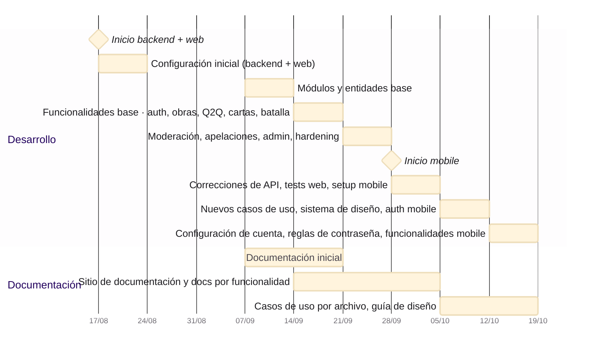
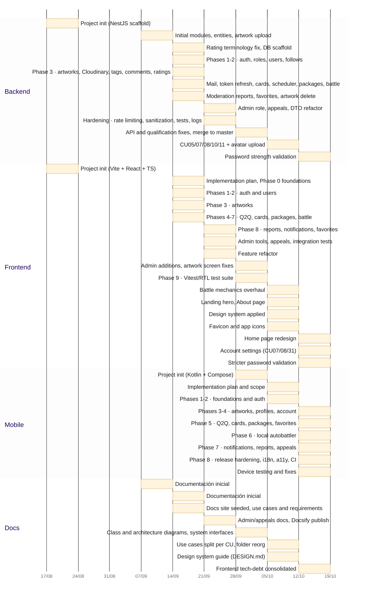

# Pandora — Cronograma del proyecto

Cronograma semanal derivado de `project-timeline.csv`. Cada barra abarca la(s) semana(s) en que se registró ese trabajo.

■ Backend · ■ Frontend · ■ Mobile · ■ Documentación

## Resumen

El trabajo de backend, frontend y mobile unificado en una única línea de desarrollo, con una barra por semana.

## Detalle por área

Detalle derivado por commits del proyecto.

